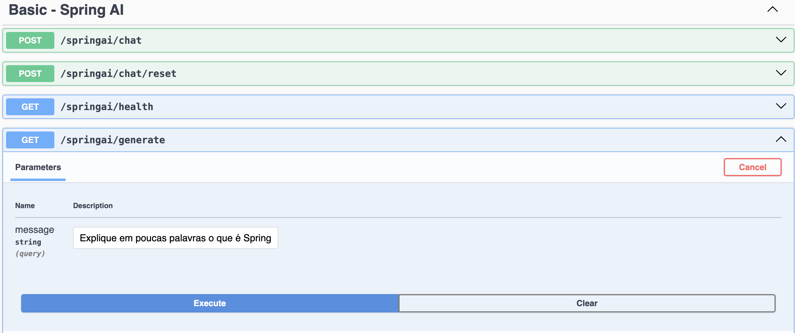
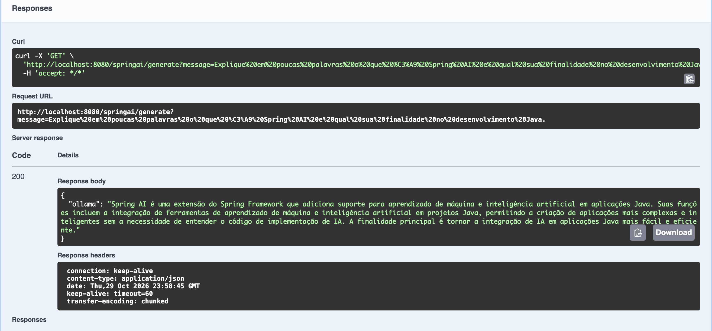
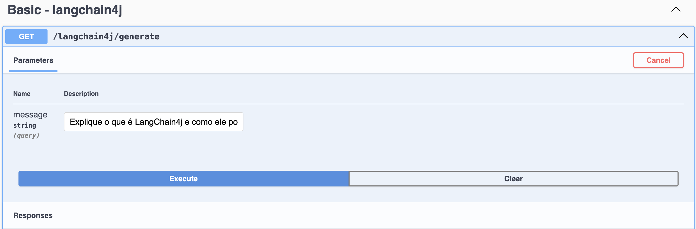
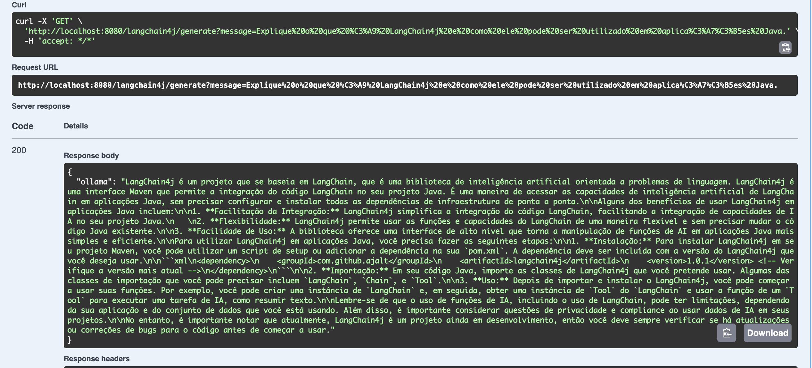
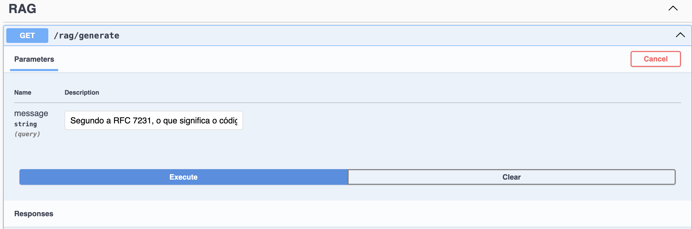
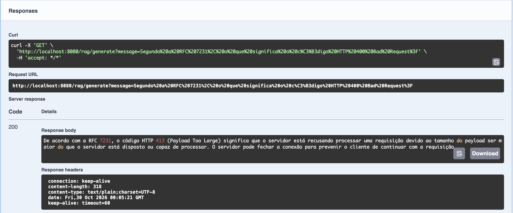
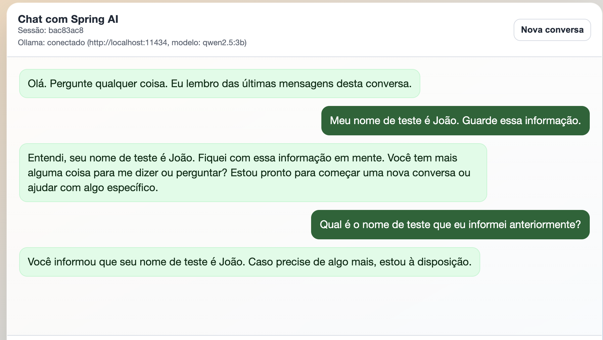

# CP6 – Java Advanced | Spring AI + LangChain4j + RAG

Aplicação Java desenvolvida a partir do [repositório base do professor](https://github.com/lgsreal/ai_example), como entrega do **Checkpoint 6 de Java Advanced**.

O objetivo da atividade é executar um modelo de linguagem local com **Ollama**, integrar esse modelo ao **Spring AI** e ao **LangChain4j**, e validar uma consulta **RAG (Retrieval-Augmented Generation)** usando embeddings e um documento de referência. A aplicação também possui uma interface web de chatbot com histórico de conversa.

## Tecnologias utilizadas

| Tecnologia | Versão / utilização |
| --- | --- |
| Java | 25 (Temurin) |
| Spring Boot | 3.5.9 |
| Gradle | 9.1.0 (Gradle Wrapper) |
| Spring AI | 1.1.4 |
| LangChain4j | 1.12.2 |
| Ollama | Execução local de modelos de IA |
| Modelo de linguagem | `qwen2.5:3b` |
| Modelo de embeddings | `nomic-embed-text` |
| Swagger UI / Springdoc | Testes e documentação da API |
| Thymeleaf | Interface web do chatbot |
| SimpleVectorStore | Armazenamento vetorial local para o RAG |

**Mudança em relação ao projeto base:** o modelo Llama foi substituído pelo **Qwen 2.5 (3B)** para geração de respostas, enquanto o **Nomic Embed Text** foi adotado para criação de embeddings. Ambos são executados localmente por meio do Ollama.

## Como executar o projeto

### 1. Pré-requisitos

- Java 25 instalado e configurado para a execução do Gradle.
- Ollama instalado e em execução.
- Conexão com a internet na primeira execução, para baixar modelos e dependências ainda não disponíveis localmente.

Para instalar os modelos no Ollama:

```bash
ollama pull qwen2.5:3b
ollama pull nomic-embed-text
```

Confira os modelos instalados:

```bash
ollama list
```

### 2. Baixar e iniciar a aplicação

Clone este repositório e acesse a pasta do projeto:

```bash
git clone https://github.com/Jounaxis/ai_example.git
cd ai_example
```

No macOS, caso haja mais de uma versão do Java instalada, selecione o Java 25 no Terminal atual:

```bash
export JAVA_HOME=$(/usr/libexec/java_home -v 25)
export PATH="$JAVA_HOME/bin:$PATH"
java -version
```

Se o script Gradle não tiver permissão para ser executado no macOS/Linux:

```bash
chmod +x gradlew
```

Inicie a aplicação:

```bash
./gradlew bootRun
```

Com o servidor iniciado, acesse:

- **Chatbot:** http://localhost:8080
- **Swagger UI:** http://localhost:8080/swagger-ui/index.html

A aplicação utiliza o servidor Ollama local no endereço `http://localhost:11434`.

## Configuração dos modelos

No arquivo `src/main/resources/application.properties`:

```properties
spring.application.name=ai_example
spring.ai.ollama.chat.model=qwen2.5:3b
spring.ai.ollama.embedding.model=nomic-embed-text
app.rag.vector-store-file=vectorstore.json
app.chat.timeout-seconds=45
```

No arquivo `src/main/java/com/luizreal/ai_example/langchain4j/Lang4jChatService.java`, foi alterado o `modelName` do `OllamaChatModel` para `qwen2.5:3b`, mantendo a URL `http://localhost:11434`.

### Cuidados com o armazenamento vetorial

Como o modelo de embeddings foi alterado, o arquivo `vectorstore.json` antigo foi removido do projeto. Na primeira consulta ao endpoint RAG, a aplicação processa o documento `src/main/resources/rfc7231.txt` e cria um novo arquivo vetorial compatível com o modelo `nomic-embed-text`.

Os arquivos `vectorstore.json` e `vectorstore.json.bak` são gerados localmente e foram adicionados ao `.gitignore`, evitando o envio de dados derivados ao repositório.

## Testes realizados na API

Os endpoints foram testados pelo Swagger UI, com o servidor Spring Boot e o Ollama executados localmente. Abaixo estão a finalidade de cada teste, a pergunta utilizada e um resumo da resposta observada.

### Teste 1 — Spring AI

**Endpoint:** `GET /springai/generate`

**Pergunta:** "Explique em poucas palavras o que é Spring AI e qual sua finalidade no desenvolvimento Java."

**Resultado observado:** a API retornou um JSON no campo `ollama` com uma explicação sobre a integração de recursos de inteligência artificial em aplicações Java por meio do Spring AI.

**Comentário:** este teste demonstra a comunicação entre o controller Spring AI, o Ollama e o modelo `qwen2.5:3b`, com geração de uma resposta a partir da pergunta recebida.




### Teste 2 — LangChain4j

**Endpoint:** `GET /langchain4j/generate`

**Pergunta:** "Explique o que é LangChain4j e como ele pode ser utilizado em aplicações Java."

**Resultado observado:** a API retornou um JSON no campo `ollama` com uma explicação sobre o uso do LangChain4j em projetos Java.

**Comentário:** o teste demonstra que a integração do LangChain4j com o modelo local no Ollama está funcionando. A resposta incluiu algumas imprecisões técnicas sobre dependências Maven, o que também evidencia a necessidade de verificar informações produzidas por modelos generativos.




### Teste 3 — RAG (Retrieval-Augmented Generation)

**Endpoint:** `GET /rag/generate`

**Pergunta:** "Segundo a seção 6.5.1 da RFC 7231, o que significa exatamente o status HTTP 400 Bad Request? Responda apenas sobre o código 400, não sobre outros códigos."

**Resultado observado:** a aplicação explicou que o HTTP **400 Bad Request** indica que o servidor não pode ou não deseja processar a requisição devido a um problema percebido na solicitação, como sintaxe inválida ou enquadramento incorreto da mensagem.

**Comentário:** a consulta utiliza trechos recuperados do documento `rfc7231.txt` por busca vetorial, com embeddings do `nomic-embed-text`. O modelo `qwen2.5:3b` gera a resposta a partir do contexto recuperado. Um teste inicial com uma pergunta menos específica retornou incorretamente o código 413; ao tornar a consulta mais precisa, a resposta passou a tratar corretamente do código 400. Essa diferença ilustra como a recuperação de contexto e a formulação da pergunta influenciam o resultado.




## Teste 4 — Chatbot web com memória de conversa

**Endereço:** `http://localhost:8080`

Na interface web foram enviadas duas mensagens na mesma sessão:

1. **Usuário:** "Meu nome de teste é João. Guarde essa informação."
2. **Usuário:** "Qual é o nome de teste que eu informei anteriormente?"

**Resultado observado:** o chatbot recuperou o nome **João**, mencionado na mensagem anterior, e respondeu corretamente à pergunta.

**Comentário:** esse teste comprova o funcionamento da interface em `localhost:8080`, a conexão com o Ollama usando o modelo `qwen2.5:3b` e a manutenção do contexto das mensagens dentro da sessão de conversa. Trata-se de memória temporária da aplicação, não de armazenamento permanente.



## Resumo dos endpoints

| Endpoint | Método | Função |
| --- | --- | --- |
| `/springai/generate` | GET | Gera uma resposta com Spring AI e Ollama |
| `/langchain4j/generate` | GET | Gera uma resposta com LangChain4j e Ollama |
| `/rag/generate` | GET | Responde usando informações recuperadas do documento de referência |
| `/springai/chat` | POST | Envia mensagens ao chatbot com histórico por sessão |
| `/springai/chat/reset` | POST | Limpa o histórico de uma sessão |
| `/springai/health` | GET | Verifica a conexão com o Ollama e informa o modelo configurado |
| `/` | GET | Exibe a interface web do chatbot |

## Conclusão

A atividade demonstrou o funcionamento de dois frameworks Java para integração com modelos de linguagem locais, **Spring AI** e **LangChain4j**, além de uma abordagem simples de **RAG com embeddings**. Os testes também mostraram a utilização de uma interface web com memória de conversa e a importância de validar a precisão das respostas geradas pela IA.

---

**Projeto base:** [lgsreal/ai_example](https://github.com/lgsreal/ai_example).
